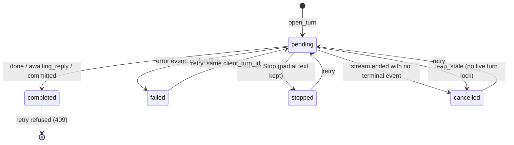
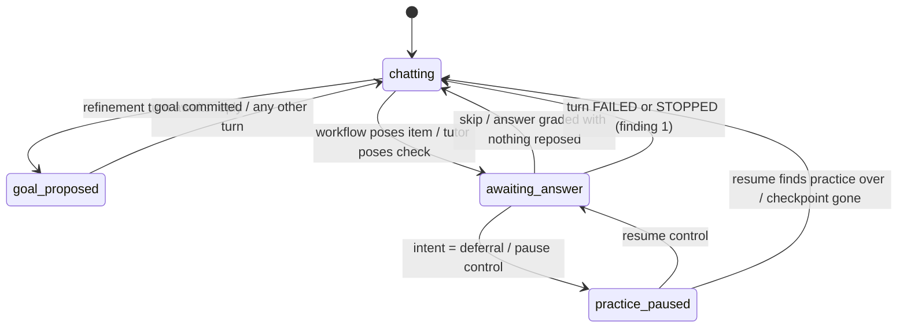
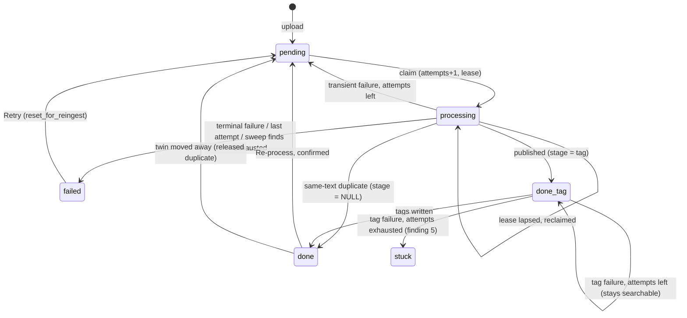
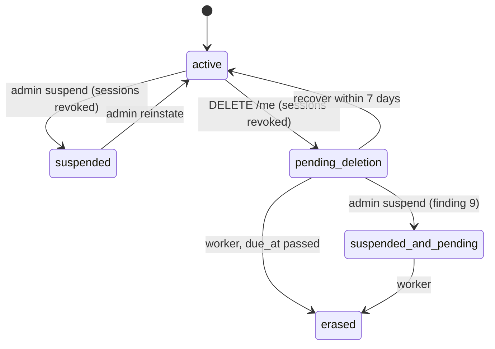
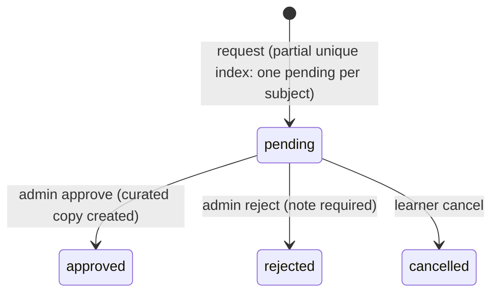
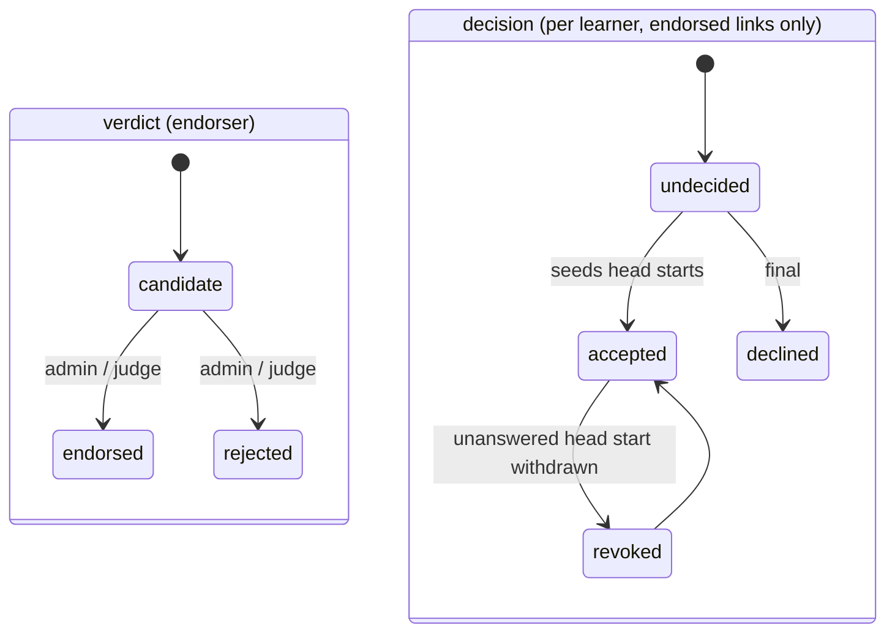
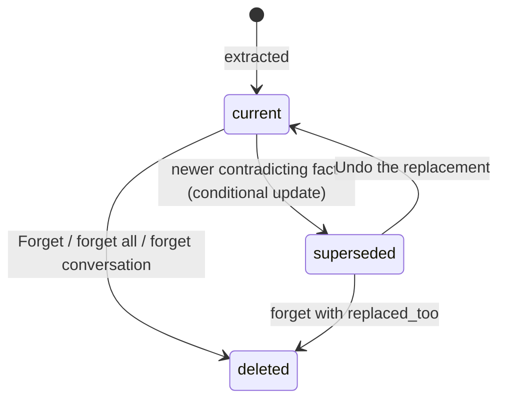

# State machines

One machine per stateful entity, drawn from the code paths that write its state (not from the
design docs). Each lists what the machine allows, the dead ends, and combinations of fields that
nothing prevents but nothing should produce. Surveyed 2026-11-16 at `2d5409d`.

Stateless functions (most of `app/`) have no machine worth drawing and are not covered.

## Findings, most serious first

| # | Entity | Finding | Evidence |
|---|---|---|---|
| 1 | Conversation phase | A failed or stopped turn overwrites the phase. If a check was open, it is closed (`chatting`, `active_item_id = NULL`), so the learner's retried answer is not graded. The comment says an interrupted turn "leaves the previous phase standing", but that is true only of a client disconnect. | `event_stream` in `app/api/v1/chat.py` calls `record_phase` after every exit from the loop. `check_open` is set only on a `done` event. `chat.py` service `_resolve_check` requires `awaiting_answer`. |
| 2 | Publication | Cancel, approve and reject check `status == pending` in Python, with no row lock or conditional update. A learner's cancel racing an admin's approve can leave `cancelled` with a published curated copy already created. Two admins racing approve and reject end the same way. | `app/services/publication.py` `cancel`, `approve`, `reject`; the routes load the row with a plain `session.get`. |
| 3 | Impersonation | The admin audit table labels every visit without `ended_at` as "expired", including a visit still in progress. A live session onto someone's account reads as finished. | `frontend/src/pages/Admin.tsx`, visit table: `row.ended_at ? … : "expired"`, with no `expires_at` comparison. |
| 4 | Memory | Undo locks the newer memory but not the one it restores. A Forget of the old memory landing between Undo's read and its write is overwritten back to `current`, bringing back a memory the learner just forgot. The `_supersede` docstring names exactly this as the thing that must not happen. | `app/services/memory.py` `undo_replacement` (`old.status = CURRENT`, unconditional) vs `delete_memory` (no lock). |
| 5 | Source | A tag stage that runs out of attempts leaves `done` + `stage = tag` + `attempts >= max`. Neither the claim nor the reconcile sweep will take it again, and nothing shows the learner. The only signal is a log line. The source is searchable but never tagged until a full re-process. | `_tag_stage` in `app/services/ingestion.py`; both selectors require `attempts < ingest_max_attempts`. |
| 6 | Source | The retag task (`_retag_source_task`, after a subject change) runs `retag_source` without claiming a lease, so it can overlap with the sweep's own tag stage for the same source. On success it also leaves any `stage = tag` set, so the sweep re-tags it again. | `app/workers/tasks.py`. |
| 7 | Turn | Retrying a turn that was stopped or hit its deadline clears `assistant_message_id` but keeps the partial reply it saved. The transcript ends up with two replies to one message, and the retry no longer knows the first one exists. If it fails again, the next retry's history includes that orphaned partial. | `open_turn` (existing branch) and `history_without` in `app/services/turn.py`. |
| 8 | Concept link | `set_admin_verdict` still checks-then-writes, while the judge's path was fixed to a conditional update. Two admins can both decide; the last write wins. Also, a verdict is final: a curated link an admin endorsed in error cannot be withdrawn, only revoked one learner at a time. | `app/services/concept_links.py` `set_admin_verdict` vs `_write_verdict`. |
| 9 | Learner account | An admin can suspend an account whose deletion is pending. Suspension blocks the recovery routes too, so the learner cannot cancel the deletion during the 7 days, and the account is erased. Probably acceptable, but nobody has decided it. | `accounts.suspend` checks only `suspended_at`; `identity.py` refuses a suspended account at sign-in, before any route (recovery included). |

Checked and sound: LLM call settlement, achievement and transfer milestones, lesson-plan steps,
invitations, and pending erasures. Notes under each entity below.

Not checked: Jev decision rows (where `used` is set), the LangGraph checkpoint's own lifecycle
beyond how it interacts with the phase, note watermarks, and profile-refresh claims.

---

## Turn (`turns.status`)

- The turn lock (`turn_lock`) makes `pending` mean "a process is running it". `reap_stale` runs
  before the claim so it can't mistake its own claim for a live turn.
- `close_turn` is best-effort. A failed write leaves `pending`, and that row is reaped as
  `cancelled`, which understates the outcome but never invents one.
- Finding 7: retrying from `stopped`, or from a deadline `failed`, orphans the partial reply.

## Conversation phase (`conversations.phase` + `active_item_id`)

- Should hold: `awaiting_answer` implies `active_item_id` is set, and `chatting` implies it is
  NULL. `record_phase` writes the two together, so that holds, except that `active_item_id` is
  `ON DELETE SET NULL`, which can leave `awaiting_answer` with no item. The grader already
  guards for that.
- The live checkpoint, not the phase, decides what the next turn does (`_choose_flow`). So a
  wrong phase in guided practice self-heals on the next message. A wrong phase on a
  tutor-posed check does not: nothing else records that the check was open.

## Source ingestion (`sources.status` + `stage` + `lease_expires_at` + `attempts`)

`done_tag` is `status = done, stage = tag`. `stuck` is `done_tag` with
`attempts >= ingest_max_attempts`, a state the code reaches but nothing leaves.

- `archived_at` is separate from this lifecycle. Retry refuses an archived source at the route,
  but the claim itself does not check `archived_at`, so a job already queued still runs. That's
  harmless, because retrieval drops archived sources anyway.
- Finding 6: the retag task is a second writer outside the claim.

## Learner account (`suspended_at`, `deletion_requested_at`, `deletion_due_at`)

- The two deletion timestamps are always set and cleared together (`retention.py`), so "one
  set, one NULL" is unreachable.

## Publication (`publications.status`)

All three outcomes are terminal by design; a new request starts a new row. Finding 2 is a race,
not a missing edge: it can produce `cancelled` or `rejected` with a published copy.

## Concept link (`concept_links.verdict` × `concept_link_decisions.decision`)

- A link is in effect only when it is `endorsed` and this learner's decision is `accepted`
  (`links_in_effect`); that combination is checked in one place.
- Allowed by the schema but not by the code: `scope = curated` with an `owner_learner_id`,
  `private` without one, and `endorsed` with `endorsed_by = NULL`. No CHECK constraint covers
  them; `sync_candidates` is the only writer, and it writes them consistently.

## Memory (`memories.status`)

`deleted` is terminal and stays recognisable, so the fact is not re-learned. Finding 4 is the
one path back out of `deleted`.

## LLM call (`llm_calls.status`): sound

`pending` (reserved at its estimate) moves to `ok`, `failed` or `partial`. A process that dies
mid-call leaves the row `pending`. It still counts at its estimate toward the 24-hour caps until
it ages out, and the ops alert reports pending rows older than 15 minutes. That's a designed
dead end with a signal.

## Lesson-plan step (`lesson_plans.steps[].status`): sound

`pending` → `active` (recomputed on every revision: the first step that is not closed or
`proposed`) → `done`. Detours: `proposed` (exploration) → `pending` (accepted) or `skipped`. An
open detour closes as `done` with the outcome `mastered` or `disproved`, and is dropped once
the step it blocked is done. Steps hold component ids as JSON with no foreign key, but no route
deletes a single component, so no step can be orphaned today. If a delete-component route is
added, it must prune plan steps.

## Learner component state (`learner_kc_state` milestones): sound

- `achieved_at` is set once and never cleared.
- A head start is provisional while `transferred_at` is set and `transfer_confirmed_at` is
  NULL. All three of its fields are set and cleared together (`seed_transfer`,
  `revoke_transfer`).
- Provisional components are excluded from mastery in all four places that judge it: the
  planner, goal status, analytics per component and topic, and the subject roll-up.

## Session, impersonation, invitation

- A session is live until `revoked_at` is set or `expires_at` passes. Every revocation closes
  its impersonation record (`_close_impersonations`). Finding 3 is how the admin page displays
  that record.
- An invitation is open (both timestamps NULL) until it is accepted or revoked. A partial
  unique index allows one open invitation per address, and both transitions check that it is
  still open first.

## Pending erasure: sound

Created when the object store or the identity provider refuses a delete, retried on
`next_attempt_at` until it succeeds, and alerted on past an attempt threshold. There is no
terminal failure state, by design ("retried until done").
